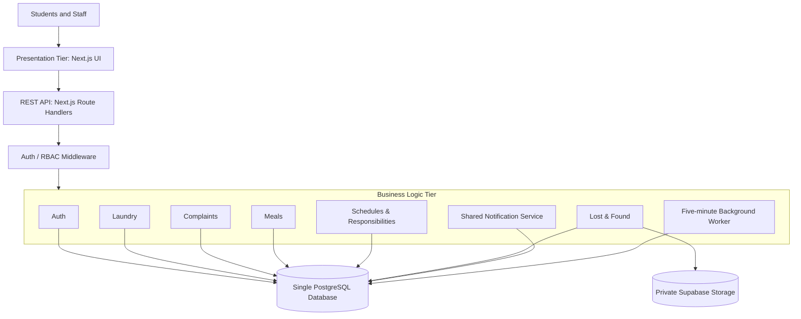

# Hostel Management System — Architecture

## 1. System Overview

The Hostel Management System helps students organize personal daily schedules, coordinate agreed shared responsibilities with roommates, manage meal-related arrangements, report hostel problems, and track complaint status and outcomes. It supports the Warden and Hostel Manager in reviewing and handling hostel issues while preserving the privacy boundaries defined in the Final PRD.

The system also supports:
- Laundry facility reservations.
- Lost and Found reporting, ownership claims, and Warden-mediated verification.
- Weekly meal menu publishing and read-only viewing by students.

The system is a coordination tool. It does not physically prepare or deliver meals and does not replace the operational responsibilities of hostel staff.

## 2. Architectural Goals / Drivers

The architecture is driven by the following requirements and concerns documented in the Final PRD and Architecture Process Evidence:

- Maintain strict privacy boundaries for student schedules, responsibilities, complaints, and Lost and Found contact details.
- Prevent simultaneous reservations for the same washing machine and time slot.
- Preserve historical meal reservation and portion-allocation information when a weekly menu is edited.
- Support the 18-hour student direct-escalation threshold and 24-hour automatic complaint-escalation threshold.
- Separate presentation, business logic, and data access.
- Support complaint tracking and laundry availability checks within the approved response-time target.
- Support the approved monthly operational availability target.

## 3. Architectural Significant Requirements (ASRs)

The Architecture Process Evidence identifies these ASRs and architectural concerns:

| ASR / Driver | Source requirement | Architectural concern |
|---|---|---|
| ASR-01 — Laundry concurrency | FR-13 / BR-10 | Simultaneous bookings for the same slot could cause double-booking. Reservation transactions must be atomic and concurrency must be handled at the data layer. |
| ASR-02 & ASR-05 — Privacy and authentication | NFR-01 / CON-02 | Four actor roles (Student, Warden, Kitchen Staff, Manager) require centralized authentication middleware, role guards, and row-level access control enforcing single-owner privacy. |
| ASR-03 — Menu decoupling | FR-15 / BR-12 | Editing a menu template must not alter historical audit logs, portion records, or existing reservation tickets. Immutable meal allocation snapshots are required. |
| ASR-04 — Escalations | FR-10 / FR-11 / BR-03 | The system must perform the 18-hour manual-escalation unlock and 24-hour automatic escalation using scheduled background checks. |
| Latency and uptime driver | NFR-02 / NFR-04 | Laundry availability and complaint tracking require efficient database access to support the approved response-time and availability targets. |

The Final PRD also defines NFR-01 privacy and access control, NFR-02 maximum 2.0-second response time for complaint tracking views and schedule updates, and NFR-04 99.0% monthly operational availability during operating term periods.

## 4. Selected Architectural Style and Rationale

**Selected style: 3-Tier Layered Architecture.**

The architecture has:
1. **Presentation Tier**
2. **Business Logic Tier**, divided into the Laundry, Complaints, Meals, and Auth domain modules
3. **Central RDBMS Data Tier**

The Architecture Process Evidence considered Modular Monolith, Microservices, and 3-Tier Layered Architecture. It records that Microservices add operational overhead, distributed transaction issues, network latency, and multi-database maintenance. It records that a pure Modular Monolith lacks standard tier separation. The selected 3-Tier Layered Architecture separates UI, Business Logic, and Data Access, supporting maintainability and transaction handling.

See [ADR-001-architecture-style.md](ADR-001-architecture-style.md).

## 5. Major Components / Modules

The Business Logic Tier is divided into six approved domain modules: Auth, Laundry, Complaints, Meals, Schedules & Responsibilities, and Lost & Found. The Notification Service is a shared capability, not a seventh domain module.

### 5.1 Presentation Tier
**Responsibility:** Provides the user interface for the system's supported student and staff workflows.

**Boundary:** Presentation is separate from business rules and data access. The selected architecture places business logic in the Business Logic Tier.

### 5.2 Auth Module
**Responsibility:** Supports stateless JWT authentication and centralized role-based access control middleware. The middleware evaluates user ID and role claims and enforces single-owner row-level access control on API endpoints before requests reach business logic.

**Boundary:** Authentication and authorization checks form the access boundary before business logic is reached. The four roles are Student, Warden, Kitchen Staff, and Manager.

See [ADR-003-authentication-boundary.md](ADR-003-authentication-boundary.md).

### 5.3 Laundry Module
**Responsibility:** Supports laundry facility reservations, availability and booked-slot checks, and cancellation of a student's own future reservation.

**Boundary:** The module's reservation operation relies on atomic relational database transactions and row locking to prevent two students from reserving the same washing machine slot simultaneously.

See [ADR-002-data-persistence-laundry-locking.md](ADR-002-data-persistence-laundry-locking.md).

### 5.4 Complaints Module
**Responsibility:** Supports identified complaint submission, complaint review and status lifecycle management, student complaint tracking, direct escalation, and automatic escalation of unresolved complaints.

**Boundary:** Students can view their own complaints only. Warden and Manager actions follow the roles and complaint workflow defined in the PRD. The 18-hour direct-escalation unlock and 24-hour automatic escalation are handled through scheduled timestamp checks.

See [ADR-005-scheduled-escalation-worker.md](ADR-005-scheduled-escalation-worker.md).

### 5.5 Meals Module
**Responsibility:** Supports meal reservations and collection arrangements, meal portion logging and Warden audit verification, and weekly meal menu creation, editing, publishing, and student read-only viewing.

**Boundary:** Menu template edits must not change existing meal reservations or historical portion allocations. Immutable snapshots are saved in the Data Layer at reservation or logging time.

See [ADR-004-immutable-meal-allocation-snapshots.md](ADR-004-immutable-meal-allocation-snapshots.md).

### 5.6 Schedules & Responsibilities Module
**Responsibility:** Owns personal schedules, rooms, room-resident assignments, shared responsibilities, and responsibility assignments.

**Boundary:** Other modules that need room information use this module's read-only Room service interface. Personal schedule and responsibility privacy rules remain enforced.

### 5.7 Lost & Found Module
**Responsibility:** Owns lost/found item reports, image references, ownership claims, Warden-mediated verification, and handover.

**Boundary:** Private contact details are not exposed to other students. Image objects are stored in a private Supabase Storage bucket; PostgreSQL stores stable object paths.

### 5.8 Shared Notification Service
**Responsibility:** Creates and stores in-app notifications, provides retrieval/read-state operations, and prevents duplicate notifications.

**Boundary:** Shared capability used by all domain modules; not a seventh domain module.

### 5.9 Central RDBMS Data Tier
**Responsibility:** Provides the central relational data store for system records and supports the data-layer responsibilities identified in the architecture decisions, including atomic laundry reservations and immutable meal allocation snapshots.

**Boundary:** Data persistence and access are separated from the Presentation and Business Logic Tiers.

## 6. Interfaces / Interactions Between Components

The documented tier and module interactions are:

1. A user interacts with the system through the Presentation Tier.
2. Requests pass through the centralized Auth middleware and RBAC guards. The middleware evaluates JWT user ID and role claims and enforces row-level access control before the request reaches business logic.
3. Authorized requests are handled by the relevant one of the six Business Logic domain modules through REST endpoints implemented as Next.js Route Handlers.
4. Route handlers validate request input with Zod and invoke module services; modules use module-specific repositories and Prisma for persistence.
5. Cross-module operations call the owning module's service interface rather than querying its tables directly.
6. The shared Notification Service owns in-app notification persistence and read state.
7. The five-minute polling worker runs in the Business Logic Tier and calls owning module services for complaint escalation and responsibility reminders.

Exact endpoint paths and complete request/response schemas are implementation-level contracts, not fixed in this architecture.

## 7. Relevant External Systems / Services

The approved implementation uses Supabase PostgreSQL for the central relational database and Supabase Storage for Lost & Found image objects.

The following are system actors or operational recipients, not specified external software integrations:
- Student
- Warden
- Hostel Manager
- Kitchen Staff

The event-driven queue broker alternatives (Kafka/RabbitMQ) and Redis locks were considered in the evidence but were not selected.

## 8. Important Data Responsibilities

### 8.1 Laundry reservation data
- The system records washing-machine reservations by machine, date, and time slot.
- Availability and booked slots are displayed.
- Overlapping reservations for the same machine are prevented.
- Reservation transactions are atomic.
- The database uses transaction isolation and row locking for this concurrency requirement.

### 8.2 Authentication and access-control data
- Stateless JWTs carry user ID and role claims.
- Centralized RBAC middleware enforces role guards and row-level access control.
- Student access is restricted to the student's own schedules, responsibilities, and complaints.
- Lost and Found claimant and finder contact information is not exposed to other students.

### 8.3 Meal and menu data
- Weekly menu templates support breakfast, lunch, and dinner by day.
- Students have read-only access to published menus by date.
- Immutable meal allocation snapshots are saved in the Data Layer at reservation or logging time.
- Menu edits do not retroactively alter existing meal reservation tickets or logged portion allocations.

### 8.4 Complaint data
- Complaints are identified and linked to an authenticated student ID.
- Complaint records include the mandatory fields defined in FR-07.
- The complaint lifecycle is Pending → In Progress → Resolved / Escalated.
- Resolved complaints are immutable. A recurring problem is recorded as a new complaint linked to the original complaint ID.
- Complaint timestamps support the 18-hour direct-escalation and 24-hour automatic-escalation rules.

### 8.5 Other PRD data responsibilities
- Personal schedules and shared responsibilities are subject to the PRD's privacy boundaries.
- Meal portion allocations and audit discrepancies are recorded for Warden verification.
- Lost and Found reports include the required item details; ownership claims are verified by the Warden, and contact details are masked from public student view.

## 9. Architectural Constraints

The architecture must preserve the following documented constraints:

- **Role and privacy control:** Role-based access control must enforce single-owner privacy for student data (NFR-01, CON-02, BR-04, BR-08, BR-11).
- **Laundry concurrency:** Two students cannot reserve the exact same washing machine slot simultaneously; reservation transactions must be atomic (BR-10).
- **Meal history integrity:** Menu template changes must not alter existing meal reservation tickets or historical portion allocations (BR-12).
- **Complaint escalation timing:** The 18-hour manual and 24-hour automatic thresholds are evaluated by the same five-minute polling cycle; each action is processed at the first scheduled check after its threshold (FR-10, FR-11, BR-03, BR-05, CON-01).
- **Complaint audit integrity:** Resolved complaints remain immutable; recurring problems are new records linked to the original complaint ID (BR-07, FR-12).
- **Response time:** Complaint tracking views and schedule updates must be displayed within a maximum response time of 2.0 seconds under standard operation (NFR-02).
- **Availability:** The system must maintain 99.0% operational availability monthly during operating term periods (NFR-04).
- **Operational scope:** The system is a coordination tool and does not replace human staff responsibilities (NG-02, CON-03).

## 10. Architecture Diagram

The current architecture diagram, including the six domain modules and shared capabilities, is provided in Section 18.

## 11. ADR References

- [ADR-001 — Architecture Style](ADR-001-architecture-style.md)
- [ADR-002 — Data Persistence: Laundry Reservation Locking](ADR-002-data-persistence-laundry-locking.md)
- [ADR-003 — Authentication Boundary](ADR-003-authentication-boundary.md)
- [ADR-004 — Immutable Meal Allocation Snapshots](ADR-004-immutable-meal-allocation-snapshots.md)
- [ADR-005 — Scheduled Escalation Worker](ADR-005-scheduled-escalation-worker.md)


## 12. Approved Technology Stack and Implementation Approach

The approved implementation stack is:

| Concern | Selected technology / decision |
|---|---|
| Web application | Next.js |
| Language | TypeScript |
| UI styling | Tailwind CSS |
| UI components | shadcn/ui |
| API transport | REST through Next.js Route Handlers |
| Input validation | Zod |
| API errors | Consistent standardized error response format |
| Relational database | PostgreSQL |
| ORM | Prisma |
| Database hosting | Supabase PostgreSQL |
| File storage | Supabase Storage, private bucket for Lost & Found images |
| Authentication | Stateless JWT |
| Password hashing | bcrypt |
| Runtime | Node.js |
| Scheduled polling | node-cron |
| Worker deployment | Local development for this deliverable; production hosting remains undecided |

The system uses one PostgreSQL database and one Prisma schema. Repositories are organized by owning module. The technology selections do not change the three-tier architecture.

### 12.1 API and module interaction

- The Presentation Tier calls REST endpoints implemented as Next.js Route Handlers.
- Route handlers validate incoming data with Zod and invoke the appropriate Business Logic service.
- Authentication and centralized RBAC middleware enforce the JWT identity, role permissions, and single-owner privacy rules before protected operations proceed.
- Business modules expose service interfaces for operations required by other modules. A module must not directly query another module's tables or bypass its business rules.
- Repository implementations encapsulate Prisma/database access and are organized by module ownership.
- API responses use a consistent success/error shape. Detailed endpoint paths and full request/response schemas are implementation-level contracts and should be documented alongside the routes when implemented.

## 13. Business Logic Modules and Shared Capabilities

The Business Logic Tier contains six domain modules:

1. **Auth:** user accounts, password hashes, roles, authentication, and authorization integration.
2. **Laundry:** machines, fixed slots, availability, reservations, cancellation, and concurrency control.
3. **Complaints:** complaint submission, review, status history, direct escalation, and automatic escalation.
4. **Meals:** weekly menus, meal reservations, portion allocations, and immutable historical snapshots.
5. **Schedules & Responsibilities:** rooms, resident assignments, personal schedules, shared responsibilities, assignments, and completion state.
6. **Lost & Found:** item reports, image references, ownership claims, Warden verification, and handover.

The **Notification Service** is a shared capability, not a seventh domain module. It owns in-app notification persistence, retrieval, read state, and duplicate prevention. Domain modules request notifications through its service interface.

The **Background Worker** is supporting infrastructure within the Business Logic Tier. It schedules and executes jobs by calling the owning module's services. It must not implement domain rules by directly updating domain tables.

## 14. Worker Scheduling, Escalations, and Reliability

A Node.js worker process uses node-cron to initiate a polling cycle every five minutes. The worker queries due work and delegates each operation to the relevant module service.

### 14.1 Complaint escalation timing

- The 18-hour manual-escalation condition and 24-hour automatic-escalation condition are evaluated by the same five-minute polling cycle.
- A threshold makes an operation eligible; it does not require execution at the exact threshold timestamp.
- The operation is processed at the first scheduled polling check after the relevant threshold has elapsed.
- At 18 hours of Warden inactivity, the worker records manual-escalation eligibility. The student still initiates the escalation.
- At 24 elapsed hours from complaint submission, an unresolved complaint is automatically escalated to the Manager.
- Resolved or otherwise ineligible complaints are not escalated.
- Repeated polling must be idempotent and must not duplicate state transitions or notifications.

The PRD defines Warden inactivity for Pending and In Progress complaints. Recorded Warden status or urgency changes reset the 18-hour clock. S08 derives the latest action from complaint status history. The 24-hour policy remains tied to submission.

### 14.2 Responsibility reminders

The agreed reminder schedule includes reminders 24 hours and 1 hour before a responsibility deadline. Completed or cancelled responsibilities are excluded. Reminder generation must be idempotent across retries and worker restarts. The PRD retains a 30-minute notification before scheduled activities. Responsibility deadlines use the approved 24-hour and 1-hour reminder schedule. Completed/cancelled responsibilities are excluded.

### 14.3 Worker processing and retries

- One worker process hosts separate job handlers, including complaint escalation and responsibility reminders.
- Polling interval: five minutes.
- Process jobs sequentially for this project baseline.
- Each job receives one initial attempt and up to three retries.
- Retry delays: 1 minute, 5 minutes, and 15 minutes.
- Persist job status, attempt count, next-attempt time, last error, and completion state in `worker_job_runs`.
- Use idempotency keys and database transactions/locking to prevent duplicate execution.
- On restart, overdue pending jobs are discovered and processed; missed polling intervals must not permanently lose due work.
- After all attempts fail, mark the job failed and retain it for administrator review.
- The worker calls module service interfaces; it does not directly implement complaint or responsibility business rules.

### 14.4 Worker deployment

For this deliverable, local development is the deployment target. The application and worker may run as separate local processes. Production hosting is intentionally undecided. The production architecture must provide a persistent Node.js process for the five-minute worker. Do not assume a normal serverless request lifecycle, including Vercel serverless functions alone, provides a continuously running worker.

## 15. Database Architecture and Logical Schema

The system uses a **single PostgreSQL database**, hosted by Supabase, with a single Prisma schema. Repositories are separated by module. Each module owns its tables and exposes service interfaces to other modules.

### 15.1 Auth module

**`users`**
- `id` UUID primary key
- `full_name` required text
- `email` required unique text
- `password_hash` required text (bcrypt hash)
- `role` required role value (Student, Warden, Kitchen Staff, Manager)
- `is_active` required boolean, default true
- `created_at`, `updated_at` timestamps

Accounts referenced by historical records are deactivated rather than physically deleted.

### 15.2 Schedules & Responsibilities module

**`rooms`**
- `id` UUID primary key
- `room_number` required unique text
- `block` optional text
- `floor` optional text
- `capacity` positive integer
- `created_at`, `updated_at` timestamps

**`room_residents`**
- `id` UUID primary key
- `room_id` FK to `rooms.id`
- `user_id` FK to `users.id`
- `assigned_at` timestamp
- `ended_at` nullable timestamp
- Indexes on `room_id`, `user_id`; enforce valid non-overlapping active assignments in service/database logic.

**`personal_schedules`**
- `id` UUID primary key
- `user_id` FK to `users.id`
- `title` required text
- `description` optional text
- `start_at`, `end_at` timestamps
- `recurrence_rule` optional text
- `created_at`, `updated_at` timestamps

**`responsibilities`**
- `id` UUID primary key
- `room_id` nullable FK to `rooms.id`
- `title`, `description`
- `due_at` timestamp
- `status` (Pending, Completed, Cancelled, and PRD-supported workflow states)
- `created_by` FK to `users.id`
- `completed_at` nullable timestamp
- `created_at`, `updated_at` timestamps

**`responsibility_assignments`**
- `id` UUID primary key
- `responsibility_id` FK to `responsibilities.id`
- `user_id` FK to `users.id`
- `assigned_at` timestamp
- `status` assignment state
- `completed_at` nullable timestamp
- Unique constraint on (`responsibility_id`, `user_id`)

### 15.3 Laundry module

**`laundry_machines`**
- `id` UUID primary key
- `name` required text
- `location` required text
- `is_active` boolean
- `created_at`, `updated_at` timestamps

**`laundry_slots`**
- `id` UUID primary key
- `machine_id` FK to `laundry_machines.id`
- `start_at`, `end_at` timestamps
- `status` (Available, Unavailable, Booked)
- Fixed duration: 60 minutes
- Unique constraint on (`machine_id`, `start_at`)

**`laundry_reservations`**
- `id` UUID primary key
- `slot_id` FK to `laundry_slots.id`
- `user_id` FK to `users.id`
- `status` (Confirmed, Cancelled, Completed)
- `booked_at` timestamp
- `cancelled_at` nullable timestamp
- Enforce at most one active reservation per slot with a PostgreSQL partial unique index; retain cancelled history.
- Booking uses a transaction and row locking per ADR-002.

### 15.4 Complaints module

**`complaints`**
- `id` UUID primary key
- `submitted_by` FK to `users.id`
- `original_complaint_id` nullable self-reference to `complaints.id` for linked follow-up/recurring complaints
- `title`, `description`, `category`
- `status` (Pending, In Progress, Resolved, Escalated, Closed as applicable to PRD workflow)
- `assigned_manager_id` nullable FK to `users.id`
- `submitted_at` timestamp
- `last_warden_action_at` nullable timestamp, if used by the approved inactivity rule
- `manual_escalation_eligible_at` nullable timestamp
- `manual_escalation_requested_at` nullable timestamp
- `auto_escalated_at` nullable timestamp
- `resolved_at` nullable timestamp
- `created_at`, `updated_at` timestamps

**`complaint_status_history`**
- `id` UUID primary key
- `complaint_id` FK to `complaints.id`
- `old_status`, `new_status`
- `changed_by` nullable FK to `users.id` (null for system-generated transition)
- `reason` optional text
- `changed_at` timestamp

### 15.5 Meals module

**`weekly_menus`**
- `id` UUID primary key
- `week_start_date` date, unique
- `status` (Draft, Published, Archived)
- `created_by` FK to `users.id`
- `created_at`, `updated_at` timestamps

**`menu_items`**
- `id` UUID primary key
- `weekly_menu_id` FK to `weekly_menus.id`
- `meal_date` date
- `meal_type` (Breakfast, Lunch, Dinner)
- `item_name` required text
- `description` optional text
- `created_at`, `updated_at` timestamps

**`meal_reservations`**
- `id` UUID primary key
- `user_id` FK to `users.id`
- `meal_date` date
- `meal_type`
- `status` (Reserved, Cancelled, Fulfilled)
- `reserved_at` timestamp

**`meal_allocation_snapshots`**
- `id` UUID primary key
- `reservation_id` FK to `meal_reservations.id`
- `menu_item_id` nullable reference to original `menu_items.id`
- `item_name_snapshot` required text
- `meal_date_snapshot` date
- `meal_type_snapshot` required value
- `portion_count` positive integer
- `snapshot_created_at` timestamp
- Snapshot values are immutable after creation, per ADR-004.

**`meal_portion_logs`**
- `id` UUID primary key
- `meal_date` date
- `meal_type` required value
- `menu_item_id` nullable FK to `menu_items.id`
- `item_name_snapshot` required text
- `portion_count` integer
- `logged_by` FK to `users.id`
- `logged_at` timestamp
- Historical item name and meal context are stored as snapshot values so menu edits do not rewrite the log.

**`meal_portion_discrepancies`**
- `id` UUID primary key
- `portion_log_id` FK to `meal_portion_logs.id`
- `recorded_by` FK to `users.id` (Warden audit actor)
- `expected_portions` integer
- `observed_portions` integer
- `description` optional text
- `recorded_at` timestamp
- Discrepancy records are retained as audit history.

### 15.6 Lost & Found module

**`lost_found_items`**
- `id` UUID primary key
- `reported_by` FK to `users.id`
- `item_type` (Lost, Found)
- `title`, `description`, `location`
- `event_date` date
- `status` (Open, Claimed, Returned, Closed)
- `created_at`, `updated_at` timestamps

**`lost_found_images`**
- `id` UUID primary key
- `item_id` FK to `lost_found_items.id`
- `storage_path` required stable path in private Supabase Storage bucket
- `uploaded_by` FK to `users.id`
- `created_at` timestamp
- Accept JPEG, PNG, WebP; maximum 5 MB each and up to 3 images per item. Enforce validation server-side. Generate signed URLs on demand with 15-minute expiry; never persist signed URLs or image binaries in PostgreSQL.

**`lost_found_claims`**
- `id` UUID primary key
- `item_id` FK to `lost_found_items.id`
- `claimant_user_id` FK to `users.id`
- `claim_description` required text
- `status` (Pending, Approved, Rejected)
- `reviewed_by` nullable FK to `users.id`
- `reviewed_at` nullable timestamp
- `handover_at` nullable timestamp
- `created_at`, `updated_at` timestamps
- Multiple claims may exist per item; only one claim may be approved/handed over. Use a transaction and uniqueness protection. Only authorized Warden/staff workflow may verify claims and record handover, consistent with PRD.

### 15.7 Shared Notification Service

**`notifications`**
- `id` UUID primary key
- `user_id` FK to `users.id`
- `type` required notification category
- `title`, `message`
- `related_module` source module
- `related_entity_id` related record identifier (polymorphic reference)
- `is_read` boolean default false
- `created_at` timestamp
- `read_at` nullable timestamp
- `deduplication_key` unique key to prevent duplicate notification creation

Notifications are in-app only. Modules request notification creation through the Notification Service. The service owns persistence and read state.

### 15.8 Worker infrastructure

**`worker_job_runs`**
- `id` UUID primary key
- `job_type` (complaint eligibility, complaint auto-escalation, responsibility reminder, and other approved worker jobs)
- `target_type`, `target_id` polymorphic target reference
- `idempotency_key` unique text
- `scheduled_for` timestamp
- `status` (Pending, Processing, Succeeded, Failed)
- `attempt_count` integer, initially 0
- `max_attempts` integer, 4 total attempts
- `next_attempt_at` nullable timestamp
- `locked_at`, `locked_by` nullable processing-lock fields
- `last_error` nullable text
- `completed_at` nullable timestamp
- `created_at`, `updated_at` timestamps

Because `target_id` is polymorphic, a conventional foreign key cannot cover every target table. The worker validates targets through owning module service interfaces. PostgreSQL locking/atomic claiming and idempotency prevent concurrent duplicate processing.

### 15.9 Data ownership and integrity

| Owner | Tables |
|---|---|
| Auth | `users` |
| Schedules & Responsibilities | `rooms`, `room_residents`, `personal_schedules`, `responsibilities`, `responsibility_assignments` |
| Laundry | `laundry_machines`, `laundry_slots`, `laundry_reservations` |
| Complaints | `complaints`, `complaint_status_history` |
| Meals | `weekly_menus`, `menu_items`, `meal_reservations`, `meal_allocation_snapshots`, `meal_portion_logs`, `meal_portion_discrepancies` |
| Lost & Found | `lost_found_items`, `lost_found_images`, `lost_found_claims` |
| Notification Service | `notifications` |
| Worker infrastructure | `worker_job_runs` |

Use primary/foreign keys, unique constraints, `NOT NULL`, `CHECK` constraints, and indexes for common ownership/status/deadline lookups. Preserve historical records where required; deactivate users, retain complaint and reservation history, preserve immutable meal snapshots, and archive/close Lost & Found records rather than deleting records needed for claims or audit history. Apply restrictive foreign-key behavior where deletion would orphan historical data.

## 16. Authentication, Security, and File Storage

- Use stateless JWT authentication with an eight-hour expiry.
- Store the JWT in an HttpOnly cookie.
- Set `Secure` in production and `SameSite=Lax`; apply CSRF protection to state-changing operations as required by the cookie-based authentication design.
- Hash passwords with bcrypt; never store plaintext passwords.
- Centralized RBAC middleware enforces Student, Warden, Kitchen Staff, and Manager permissions and single-owner privacy.
- Supabase Storage uses a private bucket for Lost & Found photos. The database stores stable object paths only.
- Validate image MIME/type and size server-side. Signed URLs expire after 15 minutes and are generated when authorized access is requested.
- Logout clears the authentication cookie. No token blacklist or refresh-token mechanism is selected for this version; a copied JWT may remain valid until its expiry.

## 17. Project Structure Baseline

The following is the approved logical organization for implementation. Adapt filenames only where required by Next.js conventions; preserve the tier and module boundaries.

```text
hostel-management-system/
├── prisma/
│   └── schema.prisma
├── src/
│   ├── app/
│   │   ├── api/
│   │   │   ├── auth/
│   │   │   ├── laundry/
│   │   │   ├── complaints/
│   │   │   ├── meals/
│   │   │   ├── schedules/
│   │   │   ├── responsibilities/
│   │   │   └── lost-found/
│   │   └── (application pages and layouts)
│   ├── components/
│   │   ├── ui/
│   │   └── shared/
│   ├── business/
│   │   ├── modules/
│   │   │   ├── auth/
│   │   │   ├── laundry/
│   │   │   ├── complaints/
│   │   │   ├── meals/
│   │   │   ├── schedules-responsibilities/
│   │   │   └── lost-found/
│   │   ├── notifications/
│   │   └── workers/
│   ├── data/
│   │   ├── repositories/
│   │   │   ├── auth/
│   │   │   ├── laundry/
│   │   │   ├── complaints/
│   │   │   ├── meals/
│   │   │   ├── schedules-responsibilities/
│   │   │   ├── lost-found/
│   │   │   └── notifications/
│   │   ├── database/
│   │   └── storage/
│   ├── shared/
│   │   ├── validation/
│   │   ├── types/
│   │   └── errors/
│   └── middleware.ts
├── .env.example
├── package.json
├── tsconfig.json
└── README.md
```

The worker should have a dedicated entry point under `src/business/workers/` (for example, scheduler, job processor, complaint-escalation job, and responsibility-reminder job files). The web application and worker may be launched as separate local processes.

## 18. Updated Architecture Diagram



## 19. ADR References

- [ADR-001 — Architecture Style](ADR-001-architecture-style.md)
- [ADR-002 — Data Persistence: Laundry Reservation Locking](ADR-002-data-persistence-laundry-locking.md)
- [ADR-003 — Authentication Boundary](ADR-003-authentication-boundary.md)
- [ADR-004 — Immutable Meal Allocation Snapshots](ADR-004-immutable-meal-allocation-snapshots.md)
- [ADR-005 — Scheduled Escalation Worker](ADR-005-scheduled-escalation-worker.md)

