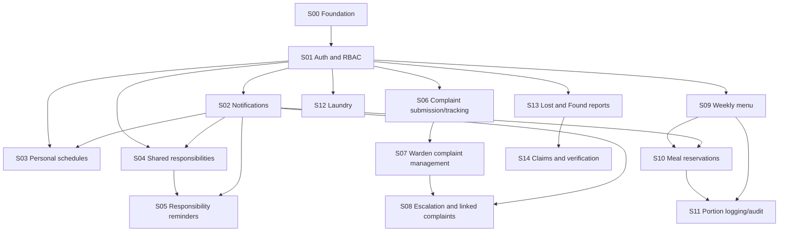

# Hostel Management System — Implementation Plan

**Document status:** Draft for team review  
**Planning horizon:** 12 days  
**Target:** Complete feature implementation by the end of Day 9, preferably by Day 7–8; reserve Days 10–12 for stabilization, testing, documentation, and demonstration preparation.  
**Team:** Five members, temporarily identified as Member 1–5  
**Source of truth:** `Final_PRD.md`, `architecture.md`, `AGENTS.md`, and the five accepted ADRs.  
**Last planning update:** 15 November 2026

---

## 1. Purpose

This document coordinates the implementation of the Hostel Management System as small, reviewable vertical slices. It records the proposed scope, dependencies, ownership, sequence, acceptance approach, unresolved decisions, and evidence expected during implementation.

This is a living plan. Update it when the team changes slice scope, ownership, priority, sequencing, estimates, or acceptance decisions. Keep meaningful history through Git commits and pull requests rather than silently overwriting important planning decisions.

This plan does not replace the PRD, architecture document, or accepted ADRs. If implementation reveals a conflict with those sources, stop the affected work, record the issue, and obtain a team decision before changing approved requirements or architecture.

## 2. Product Summary

The Hostel Management System helps hostel students organize personal schedules, coordinate agreed shared responsibilities, manage meal-related arrangements, report hostel problems, and track complaint outcomes. It supports Warden, Hostel Manager, and Kitchen Staff workflows while preserving student privacy.

The system supports hostel operations; it does not physically prepare or deliver meals and does not replace staff responsibilities.

### 2.1 In-scope capabilities

1. Authentication and role-based access control.
2. Personal schedules and shared responsibilities.
3. In-app notifications and scheduled reminders.
4. Student complaint submission and tracking.
5. Warden complaint review and status management.
6. Student direct escalation and automatic complaint escalation.
7. Weekly meal menu management, meal reservations, collection arrangements, portion logging, and audits.
8. Laundry machine reservations.
9. Lost & Found reports, search, claims, and Warden verification.

### 2.2 Roles

The system has four RBAC roles: **Student, Warden, Kitchen Staff, and Manager**. A roommate is another student participating in shared-responsibility coordination, not a separate RBAC role.

## 3. Fixed Architecture and Technology Constraints

Implementation slices must preserve the accepted architecture and ADR decisions:

- **Architecture:** 3-Tier Layered Architecture — Presentation, Business Logic, and Central RDBMS Data Tier.
- **Domain modules:** Auth, Laundry, Complaints, Meals, Schedules & Responsibilities, and Lost & Found.
- **Shared capability:** Notification Service is shared infrastructure/capability, not a seventh domain module.
- **Frontend:** Next.js, TypeScript, Tailwind CSS, and shadcn/ui.
- **API:** REST through Next.js Route Handlers; request validation with Zod; standardized API error responses.
- **Database:** One PostgreSQL database hosted by Supabase, accessed through one Prisma schema and module-specific repositories.
- **Images:** Lost & Found images use a private Supabase Storage bucket. Store stable object paths in the database and generate signed URLs on demand with 15-minute expiry.
- **Authentication:** Stateless JWT, 8-hour expiry, HttpOnly cookie, Secure in production, SameSite=Lax, bcrypt password hashing, centralized RBAC middleware, and CSRF protection where required.
- **Background processing:** Separate Node.js worker using node-cron, polling every five minutes. It must use persisted job state, idempotency, PostgreSQL locking/atomic claiming, restart recovery, and one initial attempt plus three retries with 1/5/15-minute backoff. It calls owning module service interfaces rather than directly updating domain tables.
- **Laundry concurrency:** Fixed 60-minute slots; prevent double-booking through atomic relational database transactions and row locking, not Redis locks.
- **Meal history:** Meal allocation snapshots are immutable. Menu-template edits must not alter existing reservations or historical portion allocations.
- **Deployment:** Local development is the target for this project. App and worker may run as separate local processes. Production hosting remains undecided and must support a persistent Node.js process; serverless-only hosting is insufficient for the worker.

See `architecture.md` and `Architecture_Decision_Records/` for the complete accepted decisions. Do not introduce replacement architecture or technologies without a reviewed decision and an ADR update.

## 4. Planning Approach: Slices

A **slice** is a small, demonstrable vertical increment that delivers a coherent user-facing or system capability across the relevant layers. A slice should not be treated as merely a database table, isolated UI screen, or disconnected backend endpoint.

Each detailed slice specification will be created before that slice is started. It will include:

1. **Identity and purpose:** Slice ID, title, user value, and the reason it is a separate increment.
2. **Requirement traceability:** Exact PRD FR/NFR/BR identifiers and relevant architecture/ADR references.
3. **Scope:** Included behavior, explicit exclusions, and affected roles/modules.
4. **Preconditions and dependencies:** Required earlier slices, data, services, decisions, and setup.
5. **User/system workflow:** The expected flow, including important state transitions.
6. **Implementation tasks:** Frontend, API/business logic, persistence, background work, and integration tasks as applicable. These are task boundaries, not premature endpoint/schema designs.
7. **Acceptance criteria:** Observable, testable outcomes, including authorization/privacy, failure cases, and relevant edge cases.
8. **Test plan:** Unit, integration, concurrency, authorization, and/or end-to-end checks as appropriate, with expected results.
9. **Evidence requirements:** AI interaction/task reference, human review, revisions/rejections, test output, and acceptance decision for the workflow evidence log.
10. **Ownership and estimate:** Responsible member, reviewers, planned start/finish, and status.
11. **Open questions and risks:** Unresolved details, decision owner, and whether the question blocks the slice.
12. **Definition of done:** Code reviewed, tests passing, integrated, documentation/evidence updated, and acceptance decision recorded.

### 4.1 Are all slice details already established?

**No.** The team has established a preliminary slice breakdown, broad scope, requirement mapping, logical dependencies, provisional ownership, and a draft schedule. That is enough to organize planning, but it is not yet a complete implementation specification for every slice.

The detailed acceptance criteria, exact task breakdown, test cases, interface contracts, and slice-specific edge cases still need to be written and reviewed. We will not invent unresolved business rules merely to make a slice look complete.

### 4.2 When will detailed slice specifications be created?

**Before implementation begins on the relevant slices.** The recommended sequence is:

- First, review and approve this plan and its slice boundaries.
- Next, prepare detailed specifications for the first implementation wave (S00 and S01), then the next dependent wave.
- Before each later wave starts, prepare and review the detailed specifications for those slices.
- Keep the detailed specifications in `docs/slices/` (one file per slice, such as `S01-authentication-rbac.md`) and link them from this plan.
- Do not start a slice whose required business rule is unresolved. Other independent slices may continue.

For a 12-day project, the team should not wait until all coding is underway to write acceptance criteria. At minimum, the next one or two days of work should have reviewed slice specifications ready before implementation starts.

## 5. Slice Register

The following is the **planning-level register**, not the final detailed slice specification set. Dependencies are logical prerequisites; the team may refine sequencing after reviewing actual codebase state and capacity.

| Slice | Capability | Main requirement coverage | Depends on | Proposed priority |
|---|---|---|---|---|
| S00 | Shared project foundation | Cross-cutting setup | None | P0 |
| S01 | Authentication and RBAC | Cross-cutting access/privacy; role boundaries | S00 | P0 |
| S02 | Shared notification service and inbox | FR-03, FR-04, FR-05, FR-10, FR-11 and notification needs across modules | S00, S01 | P1 |
| S03 | Personal schedule management | FR-01, relevant privacy rules | S01, S02 for reminders | P1 |
| S04 | Shared responsibility coordination and Warden assistance | FR-02, relevant privacy rules | S01, S02 | P1 |
| S05 | Responsibility reminders and incomplete-duty alerts | FR-03, FR-04 | S02, S04, worker foundation | P1 |
| S06 | Complaint submission and student tracking | FR-07, FR-09, BR-01, BR-04 | S01 | P0 |
| S07 | Warden complaint management | FR-08, BR-06, complaint lifecycle | S06 | P0 |
| S08 | Complaint escalation and linked complaints | FR-10, FR-11, FR-12; BR-02, BR-03, BR-05, BR-07 | S02, S06, S07, worker foundation | P0 |
| S09 | Weekly meal menu publishing | FR-15 | S01 | P1 |
| S10 | Meal reservations and collection arrangements | FR-05, relevant eligibility rules | S02, S09 | P1 |
| S11 | Meal portion logging and audit | FR-06, BR-09, immutable snapshot ADR | S09, S10 | P1 |
| S12 | Laundry reservations | FR-13, BR-10, ADR-002 | S01 | P0 |
| S13 | Lost & Found reporting and searching | FR-14, privacy requirements | S01 | P1 |
| S14 | Lost & Found claims and verification | FR-14, BR-11 | S13 | P1 |

**Priority meaning:** P0 is proposed as essential for the first implementation push; P1 is still in the agreed product scope and must not be silently dropped. Priority is a sequencing aid, not permission to omit requirements from the final product. The team must confirm that this prioritization is consistent with the course deliverable and available time.

### 5.1 Slice summaries

#### S00 — Shared Project Foundation
Establish the agreed repository/application baseline, local development instructions, environment-variable conventions, Prisma/PostgreSQL connection, shared validation and API error conventions, and the initial application structure. Avoid implementing domain features in this slice.

#### S01 — Authentication and RBAC
Deliver sign-in/authentication and the centralized authorization boundary for the four documented roles. Enforce user identity, role permissions, and owner-only access before business logic executes. Include security-sensitive failure handling and tests.

#### S02 — Shared Notification Service and Inbox
Provide the shared in-app notification capability: creation, retrieval, read state, and deduplication. Define and test how domain services request notifications. It is a shared capability, not a seventh domain module.

#### S03 — Personal Schedule Management
Allow a student to create, view, and update their own daily schedule. Enforce privacy so other students cannot read the student's personal schedule. Reminder behavior is covered by the relevant notification/worker slices.

#### S04 — Shared Responsibility Coordination and Warden Assistance
Allow roommates to record and coordinate agreed shared responsibilities, including the responsible student(s), and provide an explicit Request Warden Assistance action when coordination fails. The exact assignment/completion workflow needs to be detailed without exposing private personal schedule information.

#### S05 — Responsibility Reminders and Incomplete-Duty Alerts
Implement activity reminders 30 minutes before scheduled activities and responsibility reminders 24 hours and 1 hour before deadlines. Exclude completed/cancelled responsibilities. Implement the one-reminder-then-Warden-alert rule only after the team clarifies how automated non-completion timeout is determined.

#### S06 — Complaint Submission and Student Tracking
Allow identified students to submit complaints with the required category, room number, description, and urgency flag, and view only their own complaint status/outcome. Enforce required fields and ownership boundaries.

#### S07 — Warden Complaint Management
Allow the Warden to review complaints, update status through the documented lifecycle, and correct urgency/priority flags. Preserve the documented states: `Pending`, `In Progress`, `Resolved`, and `Escalated`; do not add or substitute states without a team decision.

#### S08 — Complaint Escalation and Linked Complaints
Implement student direct escalation after the approved 18-hour Warden-inactivity condition, automatic escalation after 24 elapsed hours at the first five-minute polling check after the threshold, and new linked complaint records for recurring problems or outcome disagreement as specified by the PRD. The 18-hour eligibility definition remains blocked pending team agreement (see Section 8).

#### S09 — Weekly Meal Menu Publishing
Allow authorized Kitchen Staff to create, edit, and publish weekly breakfast/lunch/dinner menus by day. Students have read-only menu access. Menu-template edits must not mutate existing reservations or historical allocations.

#### S10 — Meal Reservations and Collection Arrangements
Allow eligible students to make meal reservations and submit advance collection-difficulty notices. Route these to Kitchen Staff and provide the Warden with a read-only audit copy. Eligibility/proof rules need team clarification before they are treated as settled behavior.

#### S11 — Meal Portion Logging and Audit
Allow Kitchen Staff to log fixed meal portion allocations and the Warden to verify them. A failed audit creates a permanent Portion Discrepancy Record. Portion categories/quantities and audit details need to be specified from team decisions; preserve immutable snapshots.

#### S12 — Laundry Reservations
Allow students to view availability, reserve a washing-machine/date/time slot, and cancel their own future reservations. Slots are fixed at 60 minutes. Prevent overlapping reservations for the same machine atomically using database transactions and row locking.

#### S13 — Lost & Found Reporting and Searching
Allow students to report lost/found items with name, description, location, date, and optional image, and search listings. Protect contact information. Images follow the approved private-storage constraints.

#### S14 — Lost & Found Claims and Verification
Allow a student to claim an item and support Warden-mediated verification and handover/Returned status. Do not expose private contact details to other students.

## 6. Dependencies and Parallel Work

The following graph shows the current logical dependency proposal:



Parallel work is encouraged once shared prerequisites and service interfaces are stable. Agree on interfaces before multiple members build against the same module boundary. Integrate continuously rather than waiting until the end.

## 7. Provisional Ownership

These assignments are temporary and must be confirmed by the five-person team. Member labels are placeholders.

| Team member | Proposed primary slices | Coordination focus |
|---|---|---|
| Member 1 | S00, S01 | Foundation, authentication, cross-module access consistency |
| Member 2 | S03, S04, S05 | Schedules, responsibilities, notification/worker integration |
| Member 3 | S06, S07, S08 | Complaint lifecycle and escalation |
| Member 4 | S09, S10, S11, S13 | Meals and Lost & Found reporting |
| Member 5 | S12, S14 | Laundry concurrency and Lost & Found verification |

Ownership does not mean working in isolation. Every member should participate in integration testing, review, and understanding the complete product. Avoid making one member the sole gatekeeper for all integrations; agree on shared review and merge practices.

## 8. Open Questions, Decisions, and Blockers

Do not convert these into assumptions without a recorded team decision. A question blocks only the affected behavior unless it changes a shared foundation.

| ID | Open question / ambiguity | Current handling | Blocks |
|---|---|---|---|
| OQ-01 | What exactly qualifies as Warden inactivity for the 18-hour direct escalation rule? | **Team decision pending.** The team will discuss and agree whether eligibility applies only to complaints remaining `Pending`, or to any active complaint with no Warden action regardless of status, or another definition. Preserve the 18-hour threshold. Do not implement/finalize eligibility logic until the team agrees. | 18-hour eligibility portion of S08 only |
| OQ-02 | What duration/condition constitutes the automated timeout for confirming responsibility non-completion after the reminder? | Keep the PRD rule visible; obtain team clarification before implementing timeout behavior. | Automated timeout portion of S05 |
| OQ-03 | What is the exact responsibility assignment, acknowledgement, and completion-confirmation workflow? | Detail with the team; do not invent who can assign/confirm on behalf of whom. | Affected S04/S05 behavior |
| OQ-04 | What eligibility evidence or authorization is required for meal reservations? | Preserve the requirement for students with authorized university commitments; clarify the validation workflow. | Eligibility portion of S10 |
| OQ-05 | What are the fixed meal portion categories/quantities and what does the Warden verify? | Obtain team-approved operational values and audit rules. | Detailed S11 acceptance criteria |
| OQ-06 | What are laundry operating hours and how are reservable slots generated? | Preserve 60-minute slot duration and concurrency rule; clarify schedule availability. | Slot-generation details in S12 |
| OQ-07 | Architecture mentions `Closed` in one context while PRD lifecycle lists `Pending`, `In Progress`, `Resolved`, and `Escalated`. | Use the PRD lifecycle for planning; do not add `Closed` without reconciliation. | Complaint state implementation if `Closed` is required |
| OQ-08 | Complaint schema mentions a `title`, while PRD mandatory submission fields do not list one. | Do not make title a mandatory user input unless agreed. | Complaint form/schema detail in S06 |
| OQ-09 | Exact API paths/contracts, schema/migration details, seed data, JWT key provisioning/rotation, CI/CD, retention, monitoring, and production hosting are not fully specified. | Resolve implementation choices when needed; document decisions and avoid presenting them as already approved. | Only affected technical tasks |

### 8.1 18-hour Warden inactivity decision record

**Status: Open — team discussion required.**

The team has proposed leaving the interpretation to a collective team decision. No interpretation has been selected yet. The 18-hour threshold itself remains part of FR-10/BR-05. The separate 24-hour automatic escalation rule remains unchanged and must not be conflated with the 18-hour manual escalation rule.

Once agreed, record:
- The exact qualifying complaint statuses.
- Which Warden actions count as activity.
- Which timestamp starts or resets the inactivity period, if applicable.
- Treatment of linked follow-up complaints and complaints with an outcome.
- The approving team members/date and any resulting PRD/architecture/test updates.

## 9. Proposed 12-Day Schedule

This is a capacity-aware starting proposal, not a guarantee. Adjust it after the team confirms skills, slice estimates, and repository state. The objective is to finish implementation by Day 9 at the latest, preferably by Day 7–8.

| Day | Main focus | Target slices / work |
|---|---|---|
| 1 | Planning and foundation | Confirm plan, repo conventions, S00 |
| 2 | Access and shared capability | S01; begin S02 |
| 3 | First user workflows | S03, S04, S06 (parallel only where dependencies permit) |
| 4 | Complaint operations and module foundations | S07, S09, S12 foundation |
| 5 | Reminder/meal/lost-found workflows | S05, S10, S13 |
| 6 | Escalation, audit, laundry completion | S08 (except unresolved 18h logic), S11, S12 |
| 7 | Claims and integration | S14; cross-module integration |
| 8 | Regression and remaining feature gaps | Complete remaining in-scope work; fix integration defects |
| 9 | Feature freeze target | Acceptance review, final required feature fixes, freeze |
| 10 | Stabilization | Bug fixes, regression, authorization/privacy testing |
| 11 | Validation and documentation | End-to-end scenarios, performance checks where feasible, evidence log and contribution log |
| 12 | Demo and submission readiness | Demo rehearsal, final repository/docs review, known limitations and submission checklist |

**Scheduling rule:** Do not use Days 10–12 as planned feature-development days. They are reserved for stabilization and delivery. If a P1 slice is at risk, raise it early and agree on a recovery plan; do not silently remove it from scope.

## 10. Definition of Ready (Before a Slice Starts)

A slice may start when:

- Its detailed slice specification exists in `docs/slices/`.
- PRD requirements and relevant architecture/ADR constraints are identified.
- Scope and exclusions are clear.
- Dependencies are complete or their interfaces are agreed and stable.
- Required business decisions are resolved, or unresolved items are explicitly isolated from the work.
- Acceptance criteria are observable and testable.
- Test approach and responsible owner/reviewer are assigned.
- The team knows how the slice will be demonstrated and integrated.

## 11. Definition of Done (For Each Slice)

A slice is complete only when:

- All agreed acceptance criteria pass.
- Relevant unit/integration/end-to-end tests are run and results recorded.
- Authorization, privacy, validation, and failure cases relevant to the slice are checked.
- Code is reviewed and integrated into the shared branch.
- No known critical defect remains open for the slice.
- Documentation and workflow evidence are updated.
- Human acceptance decision is recorded as Accept, Revise, or Reject, with a reason.
- Any new architectural decision is documented through the team's agreed ADR process.

A passing test suite alone does not prove every NFR. Record actual evidence and limitations for performance, usability, and availability claims.

## 12. Cross-Cutting Validation Gates

The team should validate these throughout development, not only at the end:

- **Privacy and authorization:** Students cannot access another student's schedules, responsibilities, complaints, or private Lost & Found contact details. Staff actions are role-restricted.
- **Complaint integrity:** Mandatory fields, permitted lifecycle transitions, owner-only tracking, immutable resolved records, linked recurring complaints, and separate 18h/24h escalation behavior.
- **Worker reliability:** Five-minute polling, idempotency, persisted job state, retries, locking/atomic claiming, restart recovery, and no duplicate notifications/escalations.
- **Laundry concurrency:** Simultaneous attempts for the same machine/slot cannot create double bookings.
- **Meal history:** Menu edits cannot mutate existing reservation or allocation snapshots.
- **Storage privacy:** Lost & Found images remain in a private bucket; signed URLs are short-lived and generated on demand.
- **Usability/performance NFRs:** Gather evidence for the PRD's complaint-submission usability and response-time targets. Do not claim targets are met without measurements.
- **Integration:** Verify complete user journeys across modules and roles.

## 13. Workflow and Contribution Evidence

The final deliverable requires evidence of how work was performed, not only a finished application. Maintain these files during implementation:

- `docs/WORKFLOW_EVIDENCE_LOG.md` — one entry per slice/meaningful implementation loop, including AI interaction/task reference, context used, HITL/AFK mode and rationale, iterations, corrections or rejected AI suggestions, tests/results, human acceptance decision, issues, and integration status.
- `docs/GROUP_CONTRIBUTION_LOG.md` — contribution records for each member, including implementation, review, testing, integration, documentation, and decisions.

Update evidence as work happens. Do not reconstruct the entire log from memory at the end. The final demonstration should include at least one complete implementation loop and an example of AI output that was revised or rejected, with human reasoning recorded.

## 14. Repository Documentation Layout

```text
hostel-management-system/
├── AGENTS.md
├── Final_PRD.md
├── architecture.md
├── Architecture_Decision_Records/
│   ├── ADR-001-architecture-style.md
│   ├── ADR-002-data-persistence-laundry-locking.md
│   ├── ADR-003-authentication-boundary.md
│   ├── ADR-004-immutable-meal-allocation-snapshots.md
│   └── ADR-005-scheduled-escalation-worker.md
├── README.md
├── plan.md
├── docs/
│   ├── slices/
│   │   ├── S00-project-foundation.md
│   │   ├── S01-authentication-rbac.md
│   │   └── ... one detailed file per slice
│   ├── WORKFLOW_EVIDENCE_LOG.md
│   ├── GROUP_CONTRIBUTION_LOG.md
│   └── supporting-artefacts/
├── prisma/
├── src/
└── .env.example
```

The repository owner must invite the other team members and assign appropriate GitHub permissions. Shared access is provided by the GitHub repository; this plan does not itself grant repository access. Use commits and pull requests so each member's changes and reviews remain traceable.

## 15. Plan Change Log

| Version | Date | Change |
|---|---|---|
| v0.1 | 15 Nov 2026 | Initial planning draft: product scope, slice register, dependencies, provisional ownership, 12-day schedule, validation gates, and open decisions. Recorded 18-hour Warden inactivity interpretation as pending team discussion. |

---

## Immediate Next Actions

1. Team reviews and confirms the slice register, priorities, ownership, and schedule.
2. Team discusses OQ-01 and records the agreed 18-hour Warden inactivity definition before implementing that part of S08.
3. Prepare detailed slice specifications for S00 and S01, including preconditions, task breakdown, acceptance criteria, tests, and evidence requirements.
4. Create the README and workflow/contribution log skeletons in the repository.
5. Start implementation only when S00/S01 meet the Definition of Ready.
